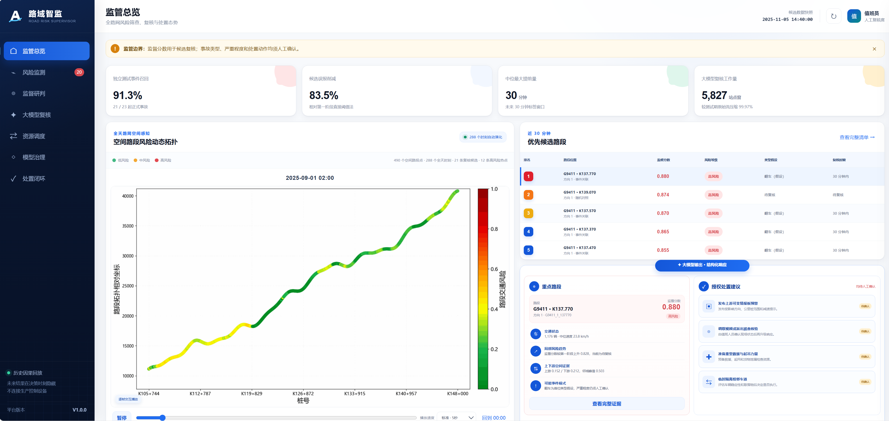
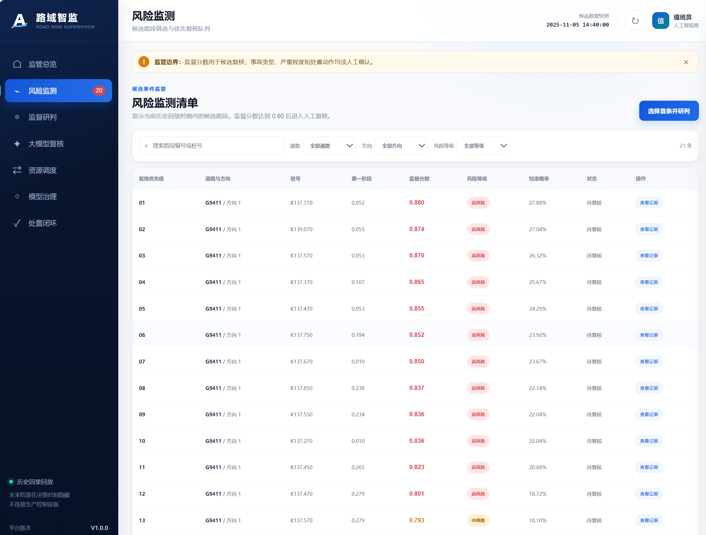
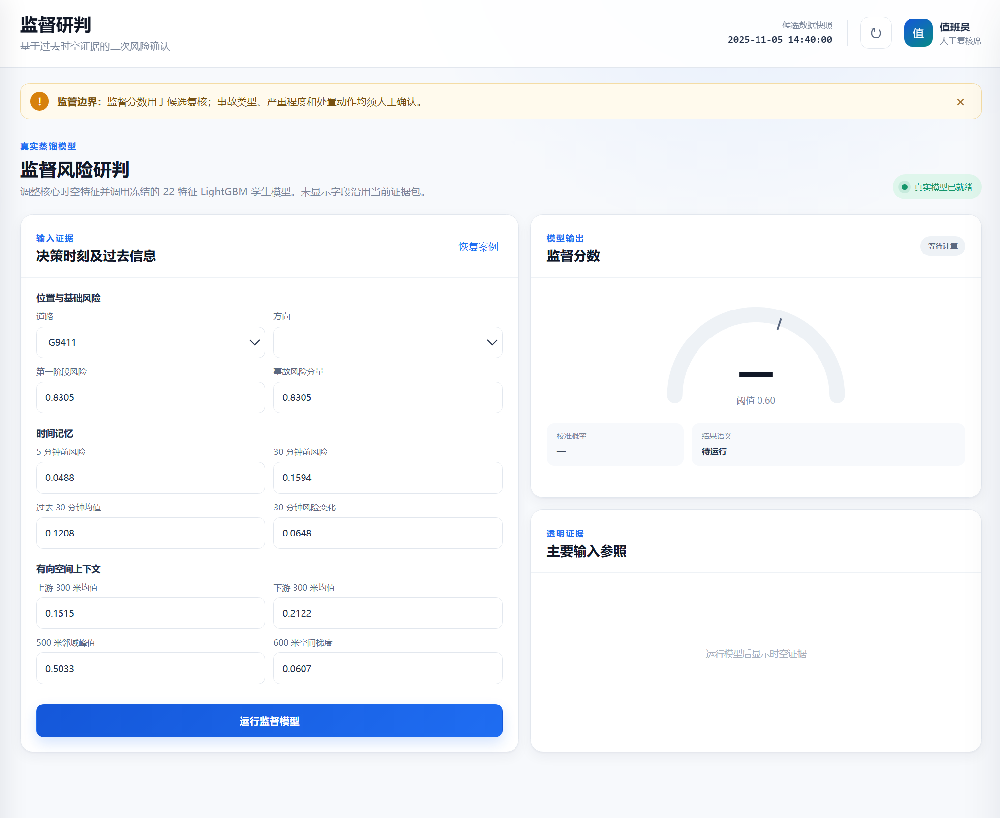
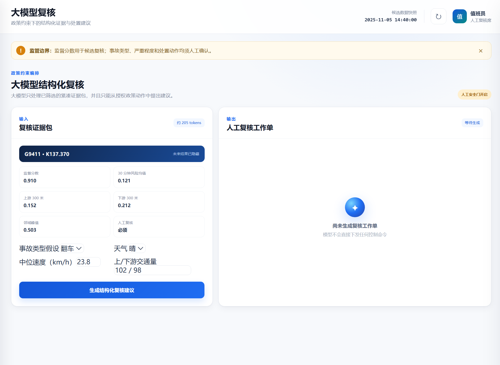
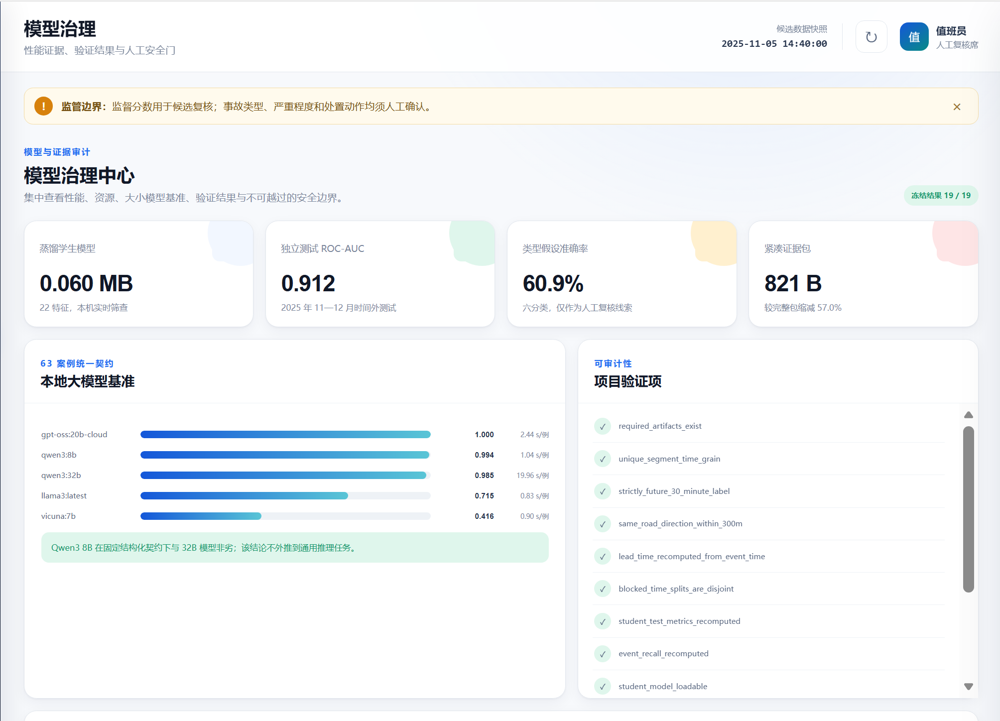
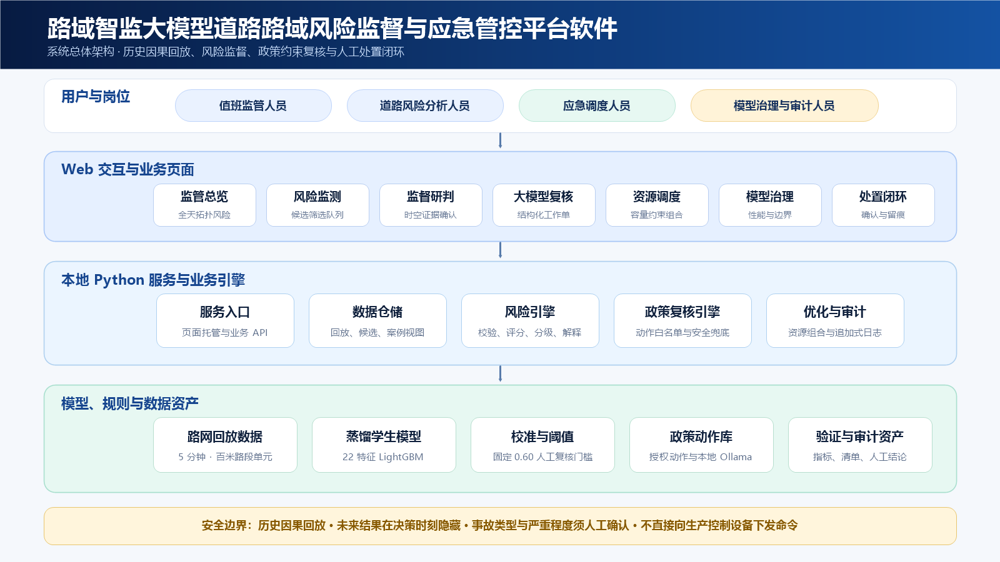
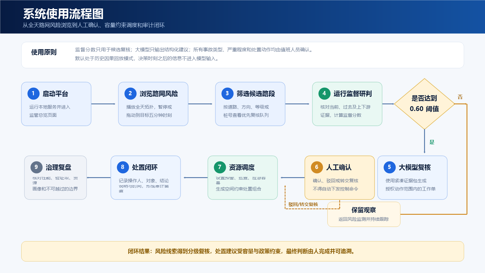

# 大模型道路路域风险监管平台

本平台把“大模型监督”研究目录中的真实模型、回放证据与政策约束组织成可运行的道路风险监管系统。平台遵循“数值模型筛查、结构化大模型复核、人工确认、容量约束调度”的业务边界，不把事故类型假设或处置建议当作自动执法指令。

平台名称：路域智监大模型道路路域风险监督与应急管控平台。系统面向值班监管人员、道路风险分析人员、应急调度人员和模型治理人员，提供从全天路网风险浏览、候选路段筛选，到监督研判、大模型复核、资源调度和处置留痕的闭环工作台。

## 已实现功能

- 监管总览：展示真实独立测试指标、工作量压缩和当前候选快照；直接载入第六章 v4 主模型在 2025-09-01 生成的 288 帧全天路网风险拓扑结果，裁去原图标题后按五分钟时刻自动播放，标准速度为每五秒切换一帧，并支持暂停、拖动和调速；同屏展示近 30 分钟候选排名、重点路段证据和授权处置建议。
- 风险监测：按道路、方向和风险等级筛选候选路段，查看时空证据。
- 监督研判：调用真实 22 特征蒸馏学生模型计算监督分数并执行阈值判断。
- 大模型复核：依据授权政策库生成结构化建议；默认采用本地安全规则，可选连接 Ollama。
- 资源调度：按预警、巡查和应急容量以及空间间隔约束形成当期建议组合。
- 模型治理：展示模型性能、大小模型基准、因果时间边界、数据限制和人工安全门。
- 处置闭环：记录人工确认、驳回和备注，形成可查询审计日志。

## 系统界面与使用流程

以下截图来自本仓库提供的离线演示界面。页面中的路段编号、时间和风险分数均来自冻结的历史回放数据，用于说明系统功能，不代表生产路网的实时状态。

### 监管总览与风险监测

监管总览集中呈现全天路网风险拓扑、近 30 分钟优先候选路段、重点证据和授权处置建议；风险监测页面支持按道路、方向和风险等级筛选候选路段，并查看待复核队列。

<p align="center">
  
  
</p>

### 监督研判与大模型复核

监督研判页面接收路段位置、方向、历史风险和邻域上下文等输入，调用蒸馏学生模型计算监督分数；大模型复核页面只处理已经筛选的证据包，在授权政策动作范围内形成结构化工作单，并保留人工确认门。

<p align="center">
  
  
</p>

### 模型治理、系统架构与使用流程

模型治理页面用于查看独立测试指标、模型基准、可审计验证项和安全边界。系统架构图和使用流程图进一步说明了 Web 页面、本地 Python 服务、风险模型、政策引擎、资源优化以及人工确认之间的关系。







`offline_pipeline/` 同步保留了形成平台模型与证据的核心离线代码，包括因果时空样本构建、确认模型训练、推理与蒸馏、实时回放、处置优化和响应族评估。在线平台不会在页面请求中重新训练模型；离线代码用于授权环境中的结果复现、模型更新和代码审计。

## 快速启动

```powershell
python server.py
```

浏览器访问 `http://127.0.0.1:8765`。系统默认使用已打包的历史因果回放快照，不会连接生产路网或下发真实控制命令。

## 可选 Ollama 接入

默认复核引擎是确定性的政策安全兜底。若需要调用本机 Ollama，可在启动前设置：

```powershell
$env:RISK_PLATFORM_USE_OLLAMA='1'
$env:RISK_PLATFORM_OLLAMA_MODEL='qwen3:8b'
python server.py
```

即使启用大模型，输出仍须通过授权动作校验和人工确认门禁。

## 数据来源与边界

演示数据来自 `大模型监督/2大模型构建及管理` 的冻结结果，包括 2025 年 11 月 5 日历史回放快照、独立测试指标、深度案例、政策库及优化摘要。系统显示的“未来 30 分钟”仅表示模型标签窗口；事故发生后的信息不会进入风险确认模型。归一化成本和缓解率是敏感性分析参数，不是已观测的因果干预效果。

## 公开仓库说明

本仓库是“大模型道路路域风险监管平台”的可复现源码镜像，基于项目私有仓库当前已跟踪的代码、配置、演示数据、轻量模型文件和前端资源整理而成。公开内容用于软件演示、代码审阅和离线复现，不连接生产路网，也不会下发真实交通控制指令。

为保护申请人隐私和研发过程资料，软著申请材料、身份证明、签章文件、专家评审整改材料、历史备份、编辑器缓存和本地密钥均未纳入本仓库。部署或二次开发时，请自行配置运行环境，不要提交 `.env`、密钥、令牌、证书等敏感信息。

目录结构和复现边界见 [`PUBLIC_REPOSITORY.md`](PUBLIC_REPOSITORY.md)。
